# OpenRCM | Pre-Bill Defense Engine

An open-source prototype that helps catch outpatient behavioral health coding problems before a claim is submitted.

OpenRCM pairs LLM-powered clinical extraction with deterministic CPT time-range rules to flag downcode risk, enforce minimum time thresholds, and provide human-in-the-loop remediation.

> **Demo only.** This is a prototype for learning and demonstration. Use synthetic notes only. Do not enter real patient information (PHI). Live demo: https://open-rcm.vercel.app

### Scope and limitations

What it checks today:
* Whether the documented session minutes support the proposed psychotherapy code, for proposed **90837** (53+ minutes), **90834** (38+ minutes), and **90832** (16+ minutes). A shortfall produces a downcode recommendation or, below 16 minutes, a hard stop.
* Whether a session duration is documented at all.
* Whether the note documents at least one symptom and at least one intervention. This is a rule in code, not a model judgment.

What it does not do:
* Modality is extracted but not yet used in any rule.
* No telehealth modifiers, place of service, or add-on codes (such as 90785), and no payer-specific rules.
* It intentionally flags downcode risk only. It never suggests moving to a higher-paying code.
* The extraction confidence score is shown to the reviewer but is not used in any decision.
* Dollar amounts shown in the UI are illustrative, not a payer fee schedule.
* PHI redaction is best-effort pattern matching and will miss things such as bare first names.
* Rate limiting is in-memory and per server instance, so it is a best-effort guard, not a hard guarantee.
* The 837P output is a sample JSON payload built in the browser. Nothing is submitted to a clearinghouse.

---

## The Problem: Downcode & Clawback Risk in Outpatient Billing

In outpatient psychotherapy billing, time-based CPT codes (e.g., 90832, 90834, 90837) are governed by CPT time ranges that payers enforce:
* CPT 90837 requires a minimum of 53 documented minutes.
* CPT 90834 covers encounters between 38 and 52 documented minutes.
* CPT 90832 covers encounters between 16 and 37 documented minutes.
* Encounters under 16 minutes fall below the billable psychotherapy threshold.

When clinicians select 90837 for a 45-minute session, clearinghouses flag the claim or commercial payers claw back reimbursement during post-payment audits, creating revenue leakage and administrative overhead.

---

## Architectural Approach

Rather than allowing a probabilistic LLM to make billing or compliance decisions, OpenRCM decouples extraction from adjudication. The model only copies facts out of the note. Plain code decides what they mean.

1. Server-Side Guardrails:
   * Per-IP rate limiting (10 requests per minute) before any model call.
   * Best-effort pattern redaction of common identifiers (SSNs, phone numbers, emails, dates, record and member IDs, street addresses, and names that follow a title or label such as "Ms." or "Patient:") before requests leave the server. This reduces exposure but does not guarantee de-identification.
   * Clamps payload size to prevent compute drain.
   * Encapsulates raw input in XML tags to mitigate prompt injection.

2. Fact Extraction (Claude + Zod):
   * Extracts session duration, modality, clinical interventions, and documented symptoms. It makes no billing judgments.
   * Prompts the model to return JSON only, then validates the response against a Zod schema before any billing logic runs. Malformed output is rejected.
   * Includes a model-reported confidence score for the reviewer.

3. Deterministic Payer Engine (`lib/adjudicate.ts`):
   * A pure TypeScript function with no API calls, covered by unit tests.
   * Applies CPT time-range rules, a documented-duration check, and a symptom-and-intervention check.
   * Quantifies downcoding risk and revenue variance.
   * Provides 1-click human-in-the-loop remediation before a sample 837P JSON payload is generated.

---

## Architecture & Data Flow

```mermaid
flowchart LR
    %% Direction and Ingestion Layer
    subgraph Layer1 ["1. Ingestion & Edge Security"]
        A([Clinician UI / Presets]) -->|"Raw Note Text"| B[app/api/scrub/route.ts]
        B --> RL[Per-IP Rate Limit: 10/min]
        RL -->|"429 if exceeded"| RLSTOP>Request Rejected]
        RL --> C[Regex PHI Stripper & 1k Char Clamp]
    end

    %% Probabilistic AI Layer
    subgraph Layer2 ["2. Probabilistic Extraction Layer"]
        C -->|"Sanitized Prompt"| D[Claude Haiku 5.5]
        D --> E{Zod Contract Check}
        E -.->|Drift / Malformed| F[Reject: Return Error]
        E -->|Validated JSON| G[(Extracted Facts Only)]
    end

    %% Deterministic Adjudication Layer
    subgraph Layer3 ["3. Deterministic Adjudication Engine (lib/adjudicate.ts)"]
        G --> H{"CPT Time Threshold Rules"}
        H -->|"Duration missing"| MISS>Warning: No Documented Duration]
        H -->|"< 16 Mins"| STOP>Fatal Stop: Non-Billable Encounter]
        H -->|"Duration found"| EVAL{"Documented Time vs Proposed CPT"}

        EVAL -->|"Time Deficit\n(90837 under 53m | 90834 under 38m)"| I>Audit Flag: Downcode Risk]
        I -->|"One-Click Remediation"| REM{"Apply Recommended Lower CPT"}
        REM -->|"CPT Updated"| N

        EVAL -->|"Time Criteria Met"| N{"Symptom AND Intervention Documented?"}
        N -.->|No| W>Warning: Medical Necessity Not Documented]
        N -->|Yes| J[Status: Audit-Ready]
    end

    %% Clearinghouse Output Layer
    subgraph Layer4 ["4. Sample Claim Serialization"]
        J --> K[Encounter Lock Engine]
        K --> L[(Sample 837P JSON Payload)]
    end

    %% Node Styling Definitions
    classDef edgeStyle fill:#0f172a,stroke:#334155,stroke-width:1px,color:#e2e8f0;
    classDef aiStyle fill:#1e1b4b,stroke:#6366f1,stroke-width:1px,color:#e0e7ff;
    classDef ruleStyle fill:#064e3b,stroke:#059669,stroke-width:1px,color:#ecfdf5;
    classDef riskStyle fill:#450a0a,stroke:#dc2626,stroke-width:1px,color:#fef2f2;
    classDef outStyle fill:#1e293b,stroke:#38bdf8,stroke-width:1px,color:#f0f9ff;

    class A,B,RL,C edgeStyle;
    class D,E,G aiStyle;
    class F,I,STOP,MISS,W,RLSTOP riskStyle;
    class H,EVAL,N,J,REM ruleStyle;
    class K,L outStyle;
```



---

## Project Structure

```
app/
  page.tsx                UI: note input, scenarios, results, sample claim
  api/scrub/route.ts      Rate limit, redact, extract with Claude, validate, adjudicate
lib/
  adjudicate.ts           Deterministic payer rules (pure function)
  adjudicate.test.ts      Rule tests, including time-boundary cases
  rateLimit.ts            In-memory per-IP fixed-window rate limiter
  rateLimit.test.ts       Rate limiter tests
```

---

## Tech Stack

* Framework: Next.js (App Router, TypeScript)
* Styling: Tailwind CSS
* Extraction: Anthropic Claude API (@anthropic-ai/sdk), Claude Haiku 5.5
* Contract Validation: Zod
* Testing: Vitest
* Deployment: Vercel

---

## Getting Started

### Prerequisites
* Node.js 22.12 or newer (the app itself needs 20.9+, but the test runner needs 22.12+)
* An Anthropic API key. If you deploy this publicly, set a spend limit on the key.

### Local Setup

1. Clone the repository:
   ```bash
   git clone https://github.com/dustin-alipour/open-rcm.git
   cd open-rcm
   ```

2. Install dependencies:
   ```bash
   npm install
   ```

3. Configure environment variables by creating a `.env.local` file in the root directory:
   ```
   ANTHROPIC_API_KEY=your_anthropic_api_key_here
   ```

4. Run the local development server:
   ```bash
   npm run dev
   ```
   Open http://localhost:3000 to view the application.

### Run the tests

```bash
npm test
```

---

## Roadmap

* Use Claude's Structured Outputs (`output_config.format`) in place of prompt-based JSON, keeping Zod as a second check.
* Add rules for modality, telehealth modifiers, place of service, and add-on codes such as 90785.

---

## License

MIT