# OpenRCM | Pre-Bill Defense Engine

An open-source prototype designed to eliminate outpatient behavioral health claim denials and audit clawbacks before submission. 

OpenRCM pairs LLM-powered clinical extraction with deterministic CMS clearinghouse rules to identify coding discrepancies, enforce minimum time thresholds, and provide human-in-the-loop remediation.

---

## The Problem: Downcode & Clawback Risk in Outpatient Billing

In outpatient psychotherapy billing, time-based CPT codes (e.g., 90832, 90834, 90837) are strictly governed by CMS and commercial payer time minimums:
* CPT 90837 requires a minimum of 53 documented minutes.
* CPT 90834 covers encounters between 38 and 52 documented minutes.
* CPT 90832 covers encounters between 16 and 37 documented minutes.
* Encounters under 16 minutes fall below the billable psychotherapy threshold.

When clinicians select 90837 for a 45-minute session, clearinghouses flag the claim or commercial payers claw back reimbursement during post-payment audits, creating revenue leakage and administrative overhead.

---

## Architectural Approach

Rather than allowing a probabilistic LLM to make direct compliance and billing decisions, OpenRCM decouples extraction from adjudication:

1. Server-Side De-Identification & Guardrails:
   * Redacts common PHI/PII patterns before requests leave the server.
   * Clamps payload size to prevent compute drain.
   * Encapsulates raw input in XML tags to guard against prompt injection.

2. Structured Extraction (Claude + Zod):
   * Extracts session duration, modality, and clinical interventions.
   * Enforces a strict JSON schema contract to eliminate conversational filler.
   * Returns a confidence score for extraction quality.

3. Deterministic Payer Engine (TypeScript):
   * Hard-coded CMS and commercial time rules calculate audit readiness.
   * Quantifies downcoding risk and revenue variance.
   * Provides 1-click human-in-the-loop remediation before ANSI X12 837P clearinghouse queuing.

---

## Architecture & Data Flow

```mermaid
flowchart LR
    %% Direction and Ingestion Layer
    subgraph Layer1 ["1. Ingestion & Edge Security"]
        A([Clinician UI / Presets]) -->|"Raw Note Text"| B[app/api/scrub/route.ts]
        B --> C[Regex PHI Stripper & 1k Char Clamp]
    end

    %% Probabilistic AI Layer
    subgraph Layer2 ["2. Probabilistic Extraction Layer"]
        C -->|"Sanitized Prompt"| D[Claude 3.5 Sonnet]
        D --> E{Zod Contract Check}
        E -.->|Drift / Malformed| F[Fallback / Log Error]
        E -->|Strict JSON| G[(Structured Clinical Entity)]
    end

    %% Deterministic Adjudication Layer
    subgraph Layer3 ["3. Deterministic Adjudication Engine"]
        G --> H{"CMS Time Threshold Rules"}
        H -->|"< 53 Mins"| I>Audit Flag: Downcode to 90834]
        H -->|">= 53 Mins"| J[Status: Ready for 90837]
        I --> K[Human-in-the-Loop Override]
        K --> J
    end

    %% Clearinghouse Output Layer
    subgraph Layer4 ["4. Clearinghouse Serialization"]
        J --> L[Encounter Lock Engine]
        L --> M[(837P JSON Payload)]
    end

    %% Node Styling Definitions
    classDef edgeStyle fill:#0f172a,stroke:#334155,stroke-width:1px,color:#e2e8f0;
    classDef aiStyle fill:#1e1b4b,stroke:#6366f1,stroke-width:1px,color:#e0e7ff;
    classDef ruleStyle fill:#064e3b,stroke:#059669,stroke-width:1px,color:#ecfdf5;
    classDef riskStyle fill:#450a0a,stroke:#dc2626,stroke-width:1px,color:#fef2f2;
    classDef outStyle fill:#1e293b,stroke:#38bdf8,stroke-width:1px,color:#f0f9ff;

    class A,B,C edgeStyle;
    class D,E,G aiStyle;
    class F,I riskStyle;
    class H,J,K ruleStyle;
    class L,M outStyle;
```

---

## Tech Stack

* Framework: Next.js (App Router, TypeScript)
* Styling: Tailwind CSS
* Extraction: Anthropic Claude API (@anthropic-ai/sdk)
* Contract Validation: Zod
* Deployment: Vercel

---

## Getting Started

### Prerequisites
* Node.js 18+
* An Anthropic API key

### Local Setup

1. Clone the repository:
   git clone https://github.com/dustin-alipour/open-rcm.git
   cd open-rcm

2. Install dependencies:
   npm install

3. Configure environment variables:
   Create a .env.local file in the root directory:
   ANTHROPIC_API_KEY=your_anthropic_api_key_here

4. Run the local development server:
   npm run dev

Open http://localhost:3000 to view the application.

---

## License

MIT